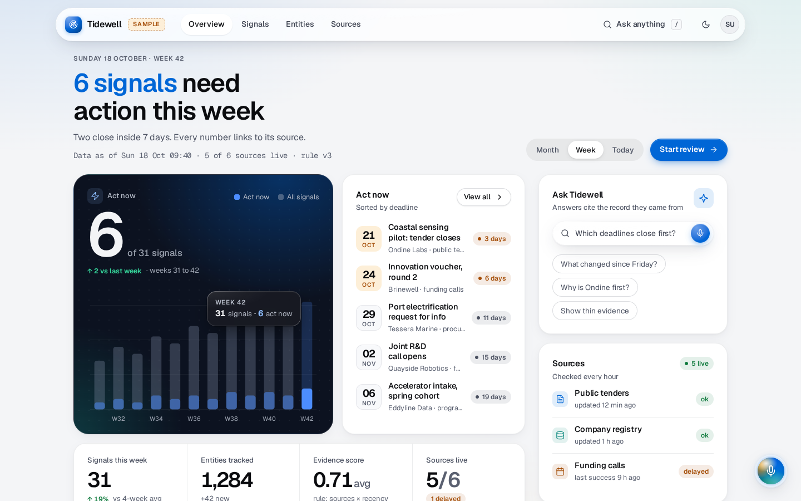
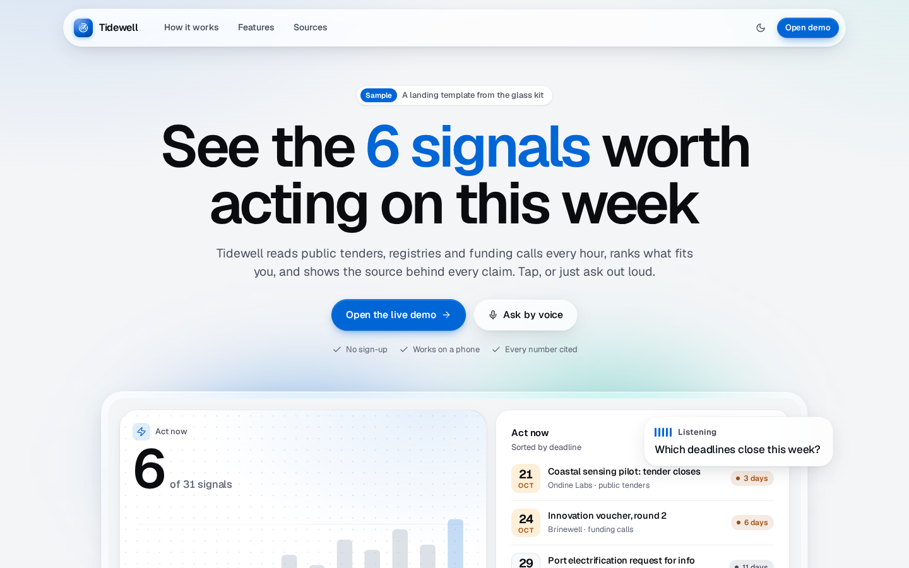
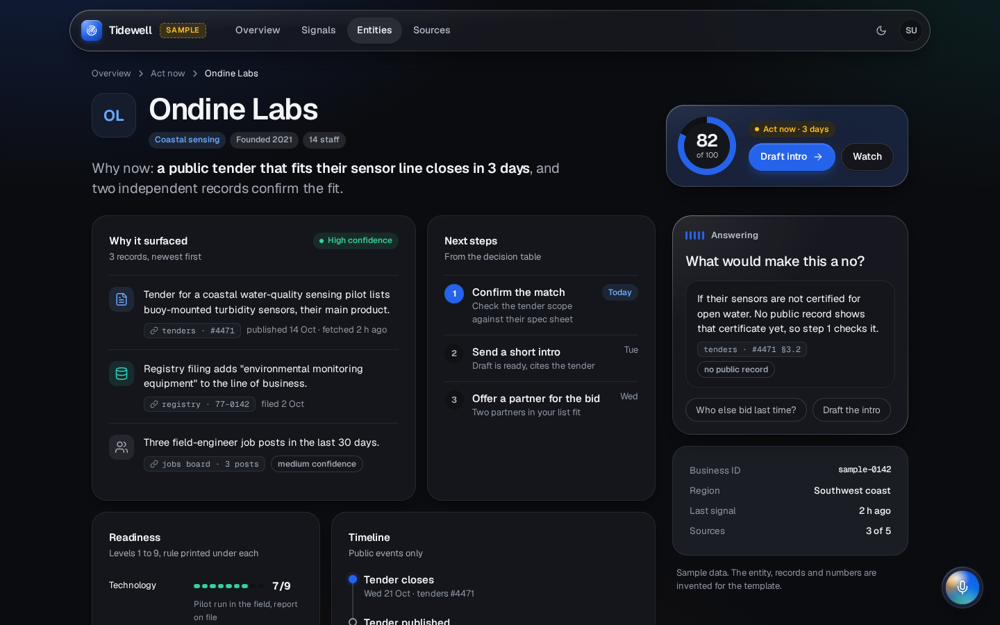
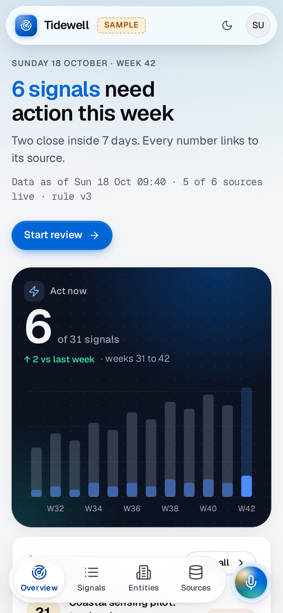
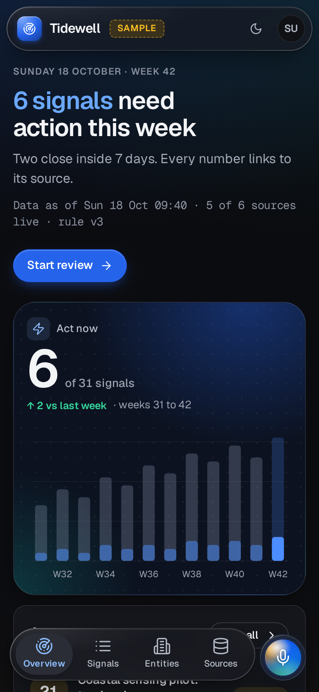

# Glass kit

A liquid-glass UI kit for 48-hour hackathon builds. Data and AI apps that need to look finished in a couple of
hours, with an iPhone-style glass control layer and a voice-assistant orb. One CSS file, one small JS file, an icon
sprite, four templates, a Tailwind preset and a shadcn theme, a reference library of 18 sites plus the two rival
apps that beat us at JunctionX Turku 2026, and the procedure (`~/.claude/skills/hack-design/SKILL.md`).



| | |
|---|---|
|  |  |
|  |  |

Before and after: see `docs/BEFORE_AFTER.md`. The side-by-side comparison images include third-party apps, so they are not published here.

## What is in it
| Path | What |
|---|---|
| `glass.css` | Tokens (colour light + dark, type, spacing, radii, shadows, glass thin/regular/thick/clear, motion) and components: floating glass nav, phone tab bar, hero, stage, KPI tiles and strip, bento grid, cards, buttons, icon tiles, segmented control, pill tabs, chips, source chips, ask bar with mic, lists with date blocks, timeline, meters, ring, data table (stacks on phones), sheet and modal (`<dialog>`), toast, empty state, skeleton, chart styles, voice orb + overlay. Prefix `g-`. |
| `glass.js` | Theme toggle, accent switch, segmented/tab state, dialogs, toasts, Chart.js defaults from tokens, `--pilot-level` setter, Chromium-only SVG refraction (`.g-refract`), a demo state machine for the orb. No dependencies. |
| `icons.svg` | 45 line icons (Lucide paths, ISC) as a sprite: `<svg class="g-i"><use href="icons.svg#search"/></svg>`. |
| `templates/` | `dashboard.html`, `detail.html`, `landing.html`, `gallery.html` (every component). Sample content, clearly labelled. |
| `tailwind/theme.css` | Tailwind v4 `@theme` with the same tokens + `glass`, `glass-thin`, `glass-thick` utilities. Compile-tested on 4.1.14. |
| `tailwind/preset.js` | Tailwind v3 preset with the same tokens. Compile-tested on 3.4.17. |
| `shadcn/globals-glass.css` | shadcn/ui variables mapped to the tokens, plus where glass goes in shadcn components. |
| `library/` | `README.md` (per-site notes), `PATTERNS.md` (15 recurring moves), `LIQUID_GLASS.md` (Apple's rules, web recipe, browser support, sources), `shots/` (1440x900 and 390x844 captures + `facts.json`). |
| `tools/` | `shoot_templates.py` (screens at 1440/390, light/dark), `contrast_check.py` (WCAG AA incl. text on glass, any URL), `capture_library.py` (re-capture references), `vendor_fonts.py` (self-host the fonts). |

## Use it in 10 minutes: plain HTML, Jinja, FastAPI
```bash
cp glass-kit/{glass.css,glass.js,icons.svg} myapp/static/
cp glass-kit/templates/dashboard.html myapp/templates/base.html   # then edit
sed -i 's#\.\./glass#/static/glass#g; s#\.\./icons.svg#/static/icons.svg#g' myapp/templates/base.html
```
1. Keep `<body class="g">`, the `.g-nav`, `.g-main.g-container` and the `.g-tabbar` + orb at the bottom.
   Point the template's relative links (`landing.html`, `detail.html`, ...) at your routes.
2. Replace the sample sentence, numbers and rows with real data (Jinja loops over `.g-list__item` and table rows).
3. Pick the accent: `<html data-accent="teal">`. Theme follows the OS; the `data-g-theme` button toggles it;
   `?theme=dark` forces it (handy for screenshots).
4. Look: `python3 tools/shoot_templates.py --base http://127.0.0.1:<port> --pages <page>` (adapt the URL pattern) or
   your screenshot tool, then `python3 tools/contrast_check.py <url>`.

Minimal page:
```html
<link rel="stylesheet" href="/static/glass.css"><script src="/static/glass.js" defer></script>
<body class="g">
  <nav class="g-nav"><a class="g-nav__brand" href="/">Product</a>
    <div class="g-nav__links"><a href="/" aria-current="page">Overview</a><a href="/list">List</a></div>
    <div class="g-nav__actions"><button class="g-btn g-btn--primary g-btn--sm">Start</button></div></nav>
  <main class="g-main g-container">
    <h1 class="g-h1"><span class="g-hl">6 signals</span> need action this week</h1>
    <div class="g-bento g-mt-6">
      <article class="g-stage g-stage--dark g-span-7">...hero number + chart...</article>
      <article class="g-card g-span-5">...act-now list...</article>
    </div>
  </main>
  <button class="g-orb-btn" data-state="idle" aria-label="Ask by voice"><span class="g-orb"></span></button>
</body>
```

## Use it in 10 minutes: Next.js 16 + Tailwind 4 (+ shadcn/ui)
```bash
cp glass-kit/glass.css web/src/app/glass.css
cp glass-kit/tailwind/theme.css web/src/app/glass-theme.css
cp glass-kit/icons.svg web/public/icons.svg
```
`src/app/globals.css`:
```css
@import "tailwindcss";
@import "./glass.css";
@import "./glass-theme.css";
@source "../app/**"; @source "../components/**"; @source "../lib/**";
```
Then `<body className="g">` in `layout.tsx` and either Tailwind utilities (`bg-surface text-ink-2 rounded-lg shadow-2
text-hero glass glass-thick`, `dark:` follows `data-theme`) or the kit classes directly (`className="g-card"`).
For shadcn/ui, replace the generated `:root` and `.dark` blocks with `shadcn/globals-glass.css` and set next-themes to
`attribute="data-theme"`. Load `glass.js` with `<Script src="/glass.js" strategy="afterInteractive" />` if you want
the toggles and refraction, or port the few lines you need. Tailwind v3 projects: `presets: [require("./preset.js")]`.

## Voice orb contract (for kits/voice-pilot)
- kits/voice-pilot as built skins itself with `--vp-*` variables on `.vp` (a dark navy HUD, its own canvas orb and
  launcher). glass.css includes a bridge: on a `body.g` page voice-pilot takes the kit's accent, font, radius and
  easing (and, in the dark theme, the kit's glass and ink). To open it from the kit's orb, put `data-pilot-open` on
  the `.g-orb-btn` and hide `.vp-launch`; otherwise use voice-pilot's own launcher and leave the kit orb out.
- The `--pilot-*` contract below is for any voice layer that renders into the kit's own orb and panel markup.
- Elements: `.g-orb-btn > .g-orb` (or any element with `[data-pilot-orb]`), panel `.g-pilot-panel` (or `[data-pilot-overlay]`),
  optional `.g-scrim`. State: `data-state="idle|listening|thinking|speaking|error"` on the orb and the panel.
- Loudness: set `--pilot-level` (0 to 1) on `<html>` each animation frame, or call `GlassKit.setPilotLevel(x)`.
  The orb scales and glows with it, `.g-wave` bars follow it.
- Variables with plain defaults: `--pilot-size` 60px (56 on phones), `--pilot-inset-x/-y` 24px (phones: 16px and
  safe-area + 14px), `--pilot-z` 1000, `--pilot-accent-2` teal, `--pilot-accent-3` amber, `--pilot-radius` 28px,
  `--pilot-panel-w`. Optional, follow the theme when unset: `--pilot-accent`, `--pilot-glow`, `--pilot-surface`,
  `--pilot-text`, `--pilot-text-2`, `--pilot-scrim`, `--pilot-font`, `--pilot-ease`.
- Panel content classes: `.g-pilot-status`, `.g-wave`, `.g-pilot-transcript` (`.is-partial` for unconfirmed words),
  `.g-pilot-answer` with `.g-source` chips.

## Accessibility and honest limits
- WCAG AA: `tools/contrast_check.py` reports 0 failures on all four templates in light and dark at 1440 and 390 px.
  Text on glass is tested against both a black and a white backdrop (worst case), which is why glass fills are fairly
  opaque (light 0.52/0.74/0.86, dark 0.66/0.82/0.90) and why greys and accent text switch to darker on-glass tokens
  inside glass. The checker does not see background images or gradients, pseudo-element text (stacked-table labels,
  delta arrows), placeholders or ancestor opacity; an independent pixel-sampling pass found one miss (the `.g-logo`
  monogram at 4.2:1), now fixed. Lowest margins are around 4.6:1 on nav links over the light field.
- Refraction (`.g-refract`) is Chromium only (Chrome, Edge, Arc, Brave). Safari and Firefox get the plain blur:
  `backdrop-filter: url()` is ignored by Safari and can drop the whole declaration in Firefox, so glass.js only sets
  it after detecting Chromium. On thick glass the effect is subtle.
- Safari 18 on macOS Sonoma ignores `var()` inside `backdrop-filter` (WebKit 297620), so blur values are literal.
  `-webkit-backdrop-filter` is kept for Safari before 18.
- `prefers-reduced-transparency` exists only in Chromium; Safari users with Reduce Transparency get the normal,
  already-legible glass. `prefers-contrast: more`, `prefers-reduced-motion`, `forced-colors` and no-backdrop-filter
  browsers all fall back to solid surfaces. Preview the fallback with `?rt=1`.
- Fixed blurred bars can stutter on older iPhones; test the deployed app on a real phone before the demo.
- Headless Chromium at device scale 2 draws `backdrop-filter` wrongly in the lower half of the viewport; the shooting
  tools launch with `--use-gl=angle --use-angle=swiftshader` to avoid it. Screens at scale 1 are unaffected.
- Fonts load from Google Fonts. For unreliable expo wifi, `python3 tools/vendor_fonts.py <static-dir>` downloads
  Geist / Geist Mono (SIL OFL) into `<static-dir>/fonts/` with a `geist.css`; swap the `@import` line in your copy of
  glass.css for `@import url("fonts/geist.css");`. Without fonts the system stack keeps the layout, not the exact look.
- The library captures are above-the-fold stills from a European server (region banners on apple.com, cookie panels);
  raycast.com's desktop capture timed out and is missing.

## License
MIT, copyright (c) 2026 The Mishakin Group. See `LICENSE`. Icon paths from Lucide (ISC). Geist and Geist Mono are
SIL Open Font License fonts served by Google Fonts. Screenshots of third-party sites are not part of this public repo; `tools/capture_library.py` recreates them locally for private reference.
